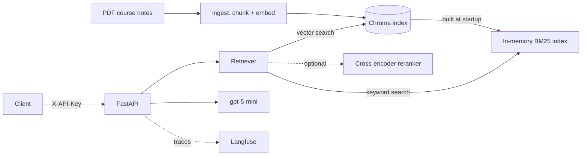

# Production RAG over Course Notes


A retrieval-augmented question-answering service over a set of PDF course notes. It answers only from the documents, cites the source file and page for every answer, and refuses when the notes don't contain the answer. The project covers the full path from ingestion to a deployed, tested, traced and evaluated API.

**Stack:** FastAPI, Chroma, BM25 + vector hybrid retrieval (optional cross-encoder reranker), OpenAI `gpt-5-mini` and `text-embedding-3-small`, Langfuse tracing, Docker, `uv`, pytest, ruff, GitHub Actions.

## Architecture



**Retrieval modes** (selectable per request with `mode`):

| Mode | What it does |
|---|---|
| `vector` | Embedding similarity search in Chroma |
| `hybrid` (default) | Vector + BM25 results merged with Reciprocal Rank Fusion |
| `hybrid_rerank` | Hybrid candidates re-scored by a cross-encoder (`ms-marco-MiniLM-L-6-v2`), loaded lazily on first use |

**Answering:** the prompt restricts the model to the retrieved context and tells it to say "I don't have enough information in the documents to answer that." when the context doesn't contain the answer. Each answer comes back with `source` and `page` citations.

## Results

Evaluated on **36 questions** (30 answerable, 6 unanswerable) written by hand from the course notes, using `gpt-5-mini` at medium reasoning effort. Each configuration was run only a few times, so read the numbers as indicative rather than precise: with 30 answerable questions, one question is worth 3.3 points.

**Final run** (`gpt-5-mini`, medium effort, recorded by `eval.run_eval`)

| Mode | hit@1 | hit@4 | MRR | correct | faithful | refusal_acc | retrieval (s) | generation (s) |
|---|---|---|---|---|---|---|---|---|
| vector | 0.97 | 1.00 | 0.98 | 1.00 | 1.00 | 1.00 | 0.86 | 5.48 |
| hybrid | 0.93 | 1.00 | 0.97 | 1.00 | 1.00 | 1.00 | 0.72 | 4.58 |
| hybrid_rerank | 0.93 | 1.00 | 0.96 | 0.93 | 0.92 | 1.00 | 1.67 | 4.56 |

Latency varies between runs with machine load and network: vector retrieval measured 0.50 s, 0.50 s and 0.86 s across the three runs.

**Stability across runs** (`correct` / `faithful`)

| Mode | Run 1 (default effort) | Run 2 (medium effort) | Final run (medium effort) | Reduced-effort run |
|---|---|---|---|---|
| vector | 0.97 / 0.97 | 0.97 / 0.92 | 1.00 / 1.00 | 0.83 / 0.86 |
| hybrid | 0.90 / 0.97 | 1.00 / 1.00 | 1.00 / 1.00 | 0.73 / 0.81 |
| hybrid_rerank | 0.90 / 0.94 | 0.87 / 0.92 | 0.93 / 0.92 | 0.80 / 0.83 |

**What the evaluation shows**

- **Retrieval is saturated on this corpus.** `hit@4` is 1.00 for every mode in every run, because the right page lands in the top four chunks however you search. `hit@1` (0.93-0.97) and MRR (0.96-0.98) differ by about one question.
- **Vector and hybrid are indistinguishable.** Over three runs at default or medium effort, `correct` was 0.97, 0.97, 1.00 for vector and 0.90, 1.00, 1.00 for hybrid. Hybrid moved by three questions between runs with the same retrieval settings, so gaps of a few questions are noise, not a ranking.
- **The reranker never beat the other modes.** It had the lowest or tied-lowest `correct` score in all three runs (0.90, 0.87, 0.93) and was the slowest. That points to no benefit, and possibly a small cost, on this corpus; I have not inspected the failing cases, so I don't claim a cause. Retrieval with the reranker took about 0.8-0.95 s longer than hybrid (1.67 s vs 0.72 s in the final run), so it is optional and loaded only when requested.
- **`hybrid` is the default for a design reason, not a measured win:** BM25 handles exact terms (names, acronyms, codes) that embeddings can blur, and its retrieval latency was no higher than vector's in any of the three runs (vector's includes an embedding API call).
- **Lowering reasoning effort hurt quality.** In a run with reasoning effort set below the default, `correct` dropped to 0.73-0.83 across all three modes. Across the three default or medium runs the lowest score was 0.87, so the ranges don't overlap, and the service uses medium effort. `gpt-5-mini` spends hidden reasoning tokens before answering, and this task benefits from them. It is still one reduced-effort run on 30 questions, so treat it as directional.

**Metric definitions**

- `hit@1` / `hit@4`: the labeled page (source file + page) is the top result / appears in the top 4 retrieved chunks. Labels are page-level so they stay valid if chunking changes.
- `MRR`: mean reciprocal rank of the first correct page.
- `correct`: an LLM judge checks that the answer contains the key facts of the reference answer. For unanswerable questions, correct means the system refused.
- `faithful`: an LLM judge checks that every claim is supported by the retrieved context.
- `refusal_acc`: share of unanswerable questions the system correctly refused.
- The judge uses the same model family as the generator, which can make it lenient. In the current code the judge is pinned to medium reasoning effort, separate from the generator's setting.

**Live service (Langfuse traces, 13 requests, Docker container, medium effort)**

| Metric | Value |
|---|---|
| End-to-end latency | mean 6.8 s, median 6.2 s, p90 9.4 s |
| Share of time in the LLM call | about 78% |
| Retrieval latency | `hybrid` about 0.7 s, `vector` about 0.9 s (median 0.5 s), `hybrid_rerank` about 2.3 s |
| Tokens per request | about 890 input, 60 visible output, 210 hidden reasoning |
| Cost | about $0.0008 per request (about $0.77 per 1,000) |
| Docker image | 4.72 GB on disk (about 1 GB compressed) |

This is a small sample, and the reranker figure includes a lazy model load on at least one request, so treat the latencies as rough.

## Quickstart (Docker)

You need Docker with the compose plugin, an OpenAI API key, and your own PDFs. The course notes used for the evaluation are private and not included in this repo.

```bash
git clone https://github.com/AUlabSAI/production-rag.git
cd production-rag

cp .env.example .env          # then fill in the values (see Configuration)
# put your PDFs in data/pdfs/

docker compose build
docker compose run --rm ingest    # builds the index (run once, and after adding PDFs)
docker compose up -d api
```

After adding or changing PDFs, run `ingest` again and then `docker compose restart api`, because the BM25 index is built at startup.

Open `http://localhost:8000/docs` for the interactive API (use **Authorize** to enter your `API_KEY`).

### API

```bash
curl -X POST http://localhost:8000/ask \
  -H "Content-Type: application/json" \
  -H "X-API-Key: $API_KEY" \
  -d '{"question": "What are the five Extreme Programming values?", "mode": "hybrid"}'
```

Response shape (illustrative):

```json
{
  "answer": "...",
  "sources": [{"source": "Agile Methodology.pdf", "page": 3}],
  "latency_ms": 5400
}
```

| Endpoint | Description |
|---|---|
| `POST /ask` | Full answer with citations |
| `POST /ask/stream` | Server-sent events: a `sources` event first, then `token` events, then `done` (or `error`) |
| `GET /health` | Liveness check with the number of indexed chunks (no auth required) |

Questions must be 3-1,000 characters, and `mode` must be one of the three retrieval modes. Invalid input returns 422, and internal failures return a generic 502 without exposing details.

## Configuration

Set in `.env`:

| Variable | Purpose |
|---|---|
| `OPENAI_API_KEY` | Required |
| `API_KEY` | Clients must send it in the `X-API-Key` header. If empty, authentication is disabled and a warning is logged |
| `LANGFUSE_PUBLIC_KEY`, `LANGFUSE_SECRET_KEY`, `LANGFUSE_BASE_URL` | Optional. Enables tracing when both keys are set |
| `REASONING_EFFORT` | `low`, `medium` (default), `high` or `routed` |

Defaults such as chunk size (1000 / overlap 100), `TOP_K` (4), the models, and the reranker model live in `app/config.py`. An experimental `routed` effort policy (a keyword router that sends explanatory "why/how" questions to high effort) is implemented but has not been evaluated and is off by default.

## Development

```bash
uv sync
uv run pytest -q          # 14 tests, no network or API keys needed
uv run ruff check .
uv run python -m app.ingest
uv run uvicorn app.api:app --port 8000
```

CI (GitHub Actions) runs lint and tests, then builds the Docker image, on every push to `main` and on pull requests.

To run the evaluation you need your own documents and a matching `eval/dataset.jsonl`:

```bash
uv run python -m eval.validate                  # checks the dataset format
MODES=vector,hybrid uv run python -m eval.run_eval my_run   # writes eval/results_my_run.json
uv run python -m eval.show_failures eval/results_my_run.json hybrid
```

On Windows PowerShell, set the variable first: `$env:MODES = "vector,hybrid"`.

## Project layout

```
app/
  config.py      settings and constants
  ingest.py      PDF loading, chunking, idempotent indexing into Chroma
  retriever.py   vector, BM25, RRF fusion, lazy reranker
  chain.py       prompt, generation, reasoning-effort policy, Langfuse tracing
  api.py         FastAPI app: auth, validation, streaming
eval/            dataset, evaluation runner, failure inspection
tests/           API contract, retrieval fusion and dataset tests
Dockerfile, docker-compose.yml, .github/workflows/ci.yml
```

## Design decisions

- **Reciprocal Rank Fusion, implemented by hand.** RRF merges the vector and BM25 lists using rank positions only, so scores from the two systems never need to be normalized. It is about 15 lines and easy to reason about.
- **Idempotent ingestion.** Chunk IDs are content hashes, so re-running ingest updates the index instead of duplicating chunks.
- **The index lives in a Docker volume, not the image.** Building it during `docker build` would put the OpenAI key into the build, and a volume survives image rebuilds. The reranker model gets its own cache volume.
- **Lazy reranker.** The default mode doesn't need it, so PyTorch and the model load on the first `hybrid_rerank` request rather than at startup.
- **Evaluation measures retrieval and generation separately,** so a bad answer can be traced to either a retrieval miss or a generation problem.
- **Streaming sends sources before tokens,** so a client can show citations while the answer is still being written.
- **Authentication with a constant-time comparison** and a health endpoint left open for container health checks.
- **Tests use a fake `app.chain`,** so the suite is fast and free, and cannot be affected by a developer's local `.env`.

## Limitations and next steps

- **PDF tables are extracted poorly.** The loader reads text in layout order, so table cells can come out interleaved (seen on a comparison table in the notes). Questions that depend on matching cells to columns may be unreliable. Next step: a layout-aware parser, measured against the existing evaluation.
- **Small evaluation.** 36 questions from one document set, single runs, and an LLM judge from the same model family. Differences of a few questions are noise, as the stability table shows. The evaluation set describes private documents, so it can't be reproduced without your own corpus.
- **No rate limiting and no TLS.** The service relies on the API key and an OpenAI spend limit. For a public deployment, put a reverse proxy in front for HTTPS and rate limiting.
- **BM25 index is in memory** and rebuilt at startup, so new documents need an API restart.
- **Streaming traces only the LLM call,** not retrieval, because tracing context doesn't carry across async generator yields.
- **The Docker image is large** (4.72 GB on disk) because of PyTorch and the embedding stack.
- **`langchain-community` (used for `PyPDFLoader`) is being deprecated.** It should be replaced when the PDF parser is upgraded.
- **The `routed` effort policy is unevaluated.**
